<!-- 🎬 HERO video intro -->

  

 

<!-- 🍥 MY NINJA WAY -->

  

<!-- 🔦 JUTSU ARSENAL -->

  

<!-- 🪪 NINJA REGISTRATION + MISSION DASHBOARD -->

  

## 🍥 S-Rank Missions

<table>
<tr><th>Mission</th><th>What it is</th><th>Jutsu used</th><th align="center">Rank</th></tr>
<tr><td><b>Kubera Web</b></td><td>Digital gold &amp; silver savings &amp; trading platform with DigiLocker KYC, DSP &amp; EMI plans</td><td><code>Angular 19</code> <code>TypeScript</code> <code>RxJS</code> <code>Spring Boot</code></td><td align="center">🏆</td></tr>
<tr><td><b>Kubera Mobile</b></td><td>Cross-platform gold &amp; silver investment mobile app with live pricing &amp; biometric auth</td><td><code>Flutter</code> <code>GetX</code> <code>Firebase</code> <code>PhonePe SDK</code></td><td align="center">📱</td></tr>
<tr><td><b>Viindhya Infinite Web</b></td><td>Fractional real estate &amp; proptech investment platform with automated KYC &amp; E2E testing</td><td><code>Angular 19</code> <code>TypeScript</code> <code>Playwright</code></td><td align="center">🏢</td></tr>
<tr><td><b>Viindhya Infinite Mobile</b></td><td>Fractional asset investment app engineered with Clean Architecture &amp; state management</td><td><code>Flutter</code> <code>BLoC</code> <code>GoRouter</code> <code>Dio</code></td><td align="center">💎</td></tr>
<tr><td><b>Viindhya Live Rates</b></td><td>Real-time bullion/gold/silver market ticker mobile app with sub-second WebSocket streams</td><td><code>Flutter</code> <code>Provider</code> <code>Lottie</code></td><td align="center">📈</td></tr>
<tr><td><b>Viindhya Bullion Desk</b></td><td>Institutional trading desk app for live bid/ask quotes &amp; bullion trading operations</td><td><code>Flutter</code> <code>Provider</code> <code>REST APIs</code></td><td align="center">🪙</td></tr>
<tr><td><a href="https://github.com/ajitchowdary/Waste_Management_System"><b>Waste Management System</b></a></td><td>Smart civic utility solution for municipal waste tracking, segregation &amp; reporting</td><td><code>Flutter</code> <code>Dart</code> <code>Firebase</code></td><td align="center">♻️</td></tr>
<tr><td><a href="https://github.com/ajitchowdary/Car_CrM"><b>Car CRM</b></a></td><td>Automotive customer relationship management &amp; inventory tracking mobile app</td><td><code>Flutter</code> <code>Dart</code></td><td align="center">🚗</td></tr>
</table>

<a href="https://github.com/ajitchowdary?tab=repositories"><b>→ Explore all repositories on GitHub</b></a>

  

### 🌃 My contribution village

*Every commit raises another building — rebuilt automatically every day.*

  

<!-- 💌 JOIN THE SQUAD -->

  

 

**Dattebayo — keep coding, keep growing.** 🍥

