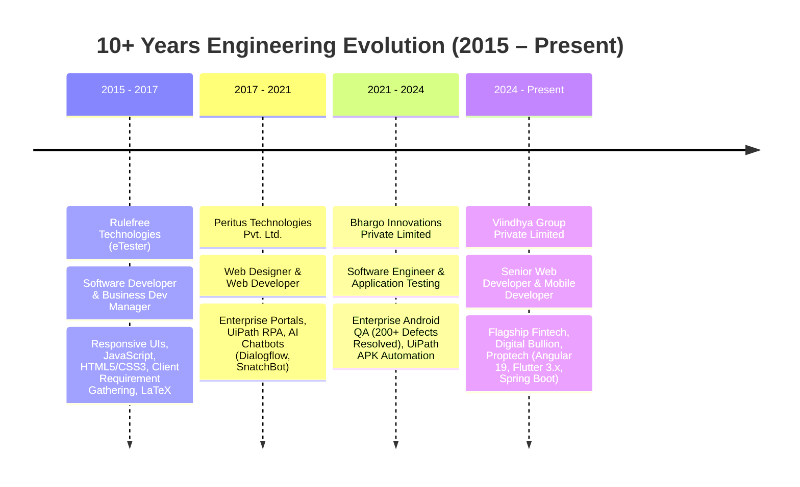

<!-- 🎬 HERO video intro -->

  

 

<!-- 🍥 MY NINJA WAY -->

  

<!-- 🔦 JUTSU ARSENAL -->

  

<!-- 🪪 NINJA REGISTRATION + MISSION DASHBOARD -->

  

<!-- ⚡ LIQUID GLASS SPECIALIZATIONS DASHBOARD -->

  

<b>📋 Expand Architectural Highlights &amp; Core Specializations (Detailed Specs)</b>

 

> **Senior Web Developer & Mobile Application Developer** with **10+ years** of progressive experience engineering scalable, resilient web platforms and high-performance cross-platform mobile apps. Proven track record delivering high-impact **Fintech**, **Digital Bullion Trading**, and **Proptech** investment platforms.

<table>
<tr>
  <td width="50%" valign="top">
    <h3>🌐 Frontend &amp; Web Engineering</h3>
    <ul>
      <li><b>Angular 19 &amp; TypeScript:</b> Modular architecture with standalone components, reactive forms, and RxJS state management.</li>
      <li><b>UI/UX Craftsmanship:</b> Custom Angular Material theming, SCSS design tokens, Bootstrap, Tailwind CSS, and AOS animations.</li>
      <li><b>E2E Testing Automation:</b> Automated Playwright test suites ensuring zero regression on multi-step onboarding and payment flows.</li>
    </ul>
  </td>
  <td width="50%" valign="top">
    <h3>📱 Mobile App Architecture</h3>
    <ul>
      <li><b>Flutter &amp; Dart:</b> Clean Architecture with BLoC, GetX, and Provider across production iOS &amp; Android apps (<b>4.5+ rating</b>).</li>
      <li><b>Deep Navigation:</b> Declarative routing using GoRouter with universal deep links and route guards.</li>
      <li><b>Real-Time Streaming:</b> High-frequency live tickers for 24K gold, 999 silver, and MCX commodities with custom spread formulas.</li>
    </ul>
  </td>
</tr>
<tr>
  <td width="50%" valign="top">
    <h3>🔐 Security, Identity &amp; Payments</h3>
    <ul>
      <li><b>Biometrics &amp; Identity:</b> Biometric authentication (Face ID / Fingerprint), SMS autofill OTP (Pinput), and DigiLocker web KYC.</li>
      <li><b>Payment Gateways:</b> PhonePe and Razorpay SDK integrations for Daily Savings Plans (DSP), gold/silver EMIs, and wallet top-ups.</li>
      <li><b>Data Security:</b> Flutter Secure Storage, encrypted token cache, and automatic JWT session renewal via HTTP interceptors.</li>
    </ul>
  </td>
  <td width="50%" valign="top">
    <h3>⚙️ API Integration &amp; Automation</h3>
    <ul>
      <li><b>Spring Boot Microservices:</b> Seamless consumption of Java Spring Boot RESTful APIs and Swagger/OpenAPI contracts.</li>
      <li><b>Network Layer:</b> Dio interceptors with automatic token refresh, request logging, and centralized error handling.</li>
      <li><b>RPA &amp; Defect Triage:</b> UiPath automated packaging scripts, AI chatbots (Dialogflow/SnatchBot), and resolution of <b>200+ enterprise defects</b>.</li>
    </ul>
  </td>
</tr>
</table>

 

 

---

## 🍥 S-Rank Missions — Flagship Production Platforms

<table>
<tr>
  <th>Mission</th>
  <th>Role &amp; Platform</th>
  <th>What it is</th>
  <th>Jutsu Arsenal</th>
  <th align="center">Live Access</th>
</tr>
<tr>
  <td><b>Kubera Web Application</b></td>
  <td>Lead Angular Developer <code>Web Platform</code></td>
  <td>
    Flagship digital gold &amp; silver savings platform featuring DSP (Daily Savings Plan), EMI installments, DigiLocker KYC, interactive payment calendars, direct bullion sale store, transaction ledgers, agent referral dashboards, and dynamic HTML/PDF purchase agreement dialogs.
  </td>
  <td><code>Angular 19</code> <code>TypeScript</code> <code>Angular Material</code> <code>RxJS</code> <code>Java Spring Boot</code> <code>JWT Interceptors</code></td>
  <td align="center"><a href="https://shop.viindhyagroup.com"><b>🌐 Live Web</b></a></td>
</tr>
<tr>
  <td><b>Kubera Mobile App</b></td>
  <td>Flutter Mobile Developer <code>iOS &amp; Android</code></td>
  <td>
    Cross-platform gold/silver investment application with real-time spot pricing, PhonePe payment gateway, in-app PDF agreement rendering, Biometric authentication (Face ID / Fingerprint), SMS autofill OTP (Pinput), and DigiLocker web KYC verification.
  </td>
  <td><code>Flutter</code> <code>Dart</code> <code>GetX</code> <code>Provider</code> <code>PhonePe SDK</code> <code>Firebase FCM</code> <code>Local Auth</code></td>
  <td align="center"><a href="https://play.google.com/store/apps/details?id=com.viindhyagroup.viindhyagold&amp;hl=en_IN"><b>📱 Play Store</b></a></td>
</tr>
<tr>
  <td><b>Viindhya Infinite Web</b></td>
  <td>Lead Frontend Developer <code>Web Platform</code></td>
  <td>
    Fractional real estate &amp; proptech investment platform allowing investors to browse fixed-income products, run investment calculators, track investor portfolio ledgers, inspect recurring payout schedules, and run business partner referral trees.
  </td>
  <td><code>Angular 19</code> <code>TypeScript</code> <code>Angular Material</code> <code>RxJS</code> <code>Spring Boot REST</code> <code>Playwright E2E</code></td>
  <td align="center"><a href="https://plans.viindhyagroup.com/"><b>🏢 Live Web</b></a></td>
</tr>
<tr>
  <td><b>Viindhya Infinite Mobile</b></td>
  <td>Flutter Mobile Developer <code>iOS &amp; Android</code></td>
  <td>
    Fractional asset investment mobile app engineered with Flutter Clean Architecture, BLoC state management for predictable user state across discovery, investor wallets, KYC, declarative GoRouter navigation, and Dio interceptors with automatic JWT token renewal.
  </td>
  <td><code>Flutter</code> <code>Dart</code> <code>BLoC Pattern</code> <code>GoRouter</code> <code>Dio</code> <code>Secure Storage</code> <code>Shimmer</code></td>
  <td align="center"><a href="https://play.google.com/store/apps/details?id=com.viindhya.infinite&amp;hl=en_IN"><b>💎 Play Store</b></a></td>
</tr>
<tr>
  <td><b>Viindhya Live Rates</b></td>
  <td>Flutter Developer <code>Live Streaming App</code></td>
  <td>
    High-performance real-time market ticker streaming live rates for 24K (999) gold, 22K (916) gold, 999 silver, and MCX commodities with live price polling, calculation formulas (TDS, GST, premium spreads), marquee rate tickers, and B2B booking forms.
  </td>
  <td><code>Flutter</code> <code>Dart</code> <code>Provider</code> <code>Dio</code> <code>Marquee Ticker</code> <code>Lottie Animations</code></td>
  <td align="center"><a href="https://play.google.com/store/apps/details?id=com.vibullion.liverates&amp;hl=en_IN"><b>📈 Play Store</b></a></td>
</tr>
<tr>
  <td><b>Viindhya Bullion Desk</b></td>
  <td>Flutter Developer <code>Trading Operations</code></td>
  <td>
    Dedicated physical bullion trading desk application displaying live bullion bid/ask rates, operational market status, minted coin/bar product catalogs, and one-touch trading desk connectivity via WhatsApp and direct telephone dialing.
  </td>
  <td><code>Flutter</code> <code>Dart</code> <code>Provider</code> <code>REST APIs</code> <code>URL Launcher</code></td>
  <td align="center"><a href="https://play.google.com/store/apps/details?id=com.viindhyagroup.bullion&amp;hl=en_IN"><b>🪙 Play Store</b></a></td>
</tr>
<tr>
  <td><a href="https://github.com/ajitchowdary/Waste_Management_System"><b>Waste Management System</b></a></td>
  <td>Mobile Architect <code>Public Open Source</code></td>
  <td>
    Smart civic utility solution for municipal waste tracking, segregation, citizen grievance reporting, and automated route management.
  </td>
  <td><code>Flutter</code> <code>Dart</code> <code>Firebase</code> <code>Clean Architecture</code></td>
  <td align="center"><a href="https://github.com/ajitchowdary/Waste_Management_System"><b>⚡ GitHub</b></a></td>
</tr>
<tr>
  <td><a href="https://github.com/ajitchowdary/Car_CrM"><b>Car CRM</b></a></td>
  <td>Mobile Developer <code>Public Open Source</code></td>
  <td>
    Automotive customer relationship management and inventory tracking cross-platform application with smooth custom UI/UX flows.
  </td>
  <td><code>Flutter</code> <code>Dart</code> <code>UI/UX Design</code></td>
  <td align="center"><a href="https://github.com/ajitchowdary/Car_CrM"><b>🚗 GitHub</b></a></td>
</tr>
</table>

 

---

## 🏛️ Enterprise, State Government & Automation Solutions

<table>
<tr><th>Initiative / Platform</th><th>Client / Domain</th><th>Contribution &amp; Tech Stack</th></tr>
<tr>
  <td><b>EPANTA (E-Crop Booking System)</b></td>
  <td>State Government of Andhra Pradesh</td>
  <td>Large-scale agricultural crop recording, land verification, and field monitoring mobile app built with <code>Android SDK</code> and <code>RESTful APIs</code>.</td>
</tr>
<tr>
  <td><b>Real-Time Outcome Monitoring (APSDPS)</b></td>
  <td>Andhra Pradesh State Dev Planning Society</td>
  <td>State government outcome budget indicator dashboards and citizen metrics reporting portal engineered using <code>HTML5</code>, <code>CSS3</code>, <code>JavaScript</code>, and <code>Bootstrap</code>.</td>
</tr>
<tr>
  <td><b>AP Innovation Society Portal</b></td>
  <td>Government Incubator &amp; Startups</td>
  <td>Startup ecosystem and incubation monitoring platform designed with <code>HTML5</code>, <code>CSS3</code>, <code>JavaScript</code>, and <code>Bootstrap</code>.</td>
</tr>
<tr>
  <td><b>Sericulture E-Marketing Platform</b></td>
  <td>Agri-Market &amp; Auction Portal</td>
  <td>Web auction platform UI for real-time cocoon price discovery and trader bidding using <code>PHP</code>, <code>CodeIgniter</code>, and <code>MySQL</code>.</td>
</tr>
<tr>
  <td><b>Bhargo Platform</b></td>
  <td>Enterprise Android Automation</td>
  <td>Automated mobile testing pipelines, build scripts with <code>UiPath RPA</code>, and automated APK packaging, resolving <b>200+ functional &amp; UI defects</b>.</td>
</tr>
</table>

 

---

## 📜 Career Arc — 10+ Years Professional Chronicle

<table>
<tr><th>Organization</th><th>Role</th><th>Tenure &amp; Location</th><th>Core Impact</th></tr>
<tr>
  <td><b>Viindhya Group Private Limited</b></td>
  <td><b>Senior Web Developer &amp; Mobile Developer</b></td>
  <td><code>March 2024 – Present</code> Hyderabad, India</td>
  <td>
    • Spearheaded frontend and mobile engineering for flagship fintech &amp; bullion platforms across <b>Angular 19</b> and <b>Flutter 3.x</b>. 
    • Integrated Java Spring Boot REST APIs with JWT session renewal, HTTP request/response interceptors, and centralized error handling. 
    • Built secure payment gateways (PhonePe &amp; Razorpay SDKs) for Daily Savings Plans (DSP), gold/silver EMIs, and wallet top-ups. 
    • Architected mobile apps with Clean Architecture &amp; BLoC/GetX/Provider, achieving a <b>4.5+ user rating</b>. 
    • Streamed real-time 24K gold, 999 silver, and MCX commodities tickers with low latency. 
    • Integrated Biometric security (Face ID / Fingerprint), SMS OTP autofill (Pinput), DigiLocker web KYC, and Playwright E2E suites.
  </td>
</tr>
<tr>
  <td><b>Bhargo Innovations Private Limited</b></td>
  <td><b>Software Engineer &amp; Application Testing</b></td>
  <td><code>April 2021 – Feb 2024</code> Hyderabad, India</td>
  <td>
    • Executed rigorous functional and UI defect triage across enterprise Android applications, resolving <b>200+ defects</b>. 
    • Developed automated debugging and build scripts using <b>UiPath RPA</b>, accelerating automated APK release cycles. 
    • Collaborated closely with UI/UX designers and backend developers to deliver cohesive, high-performance user interfaces. 
    • Prepared technical documentation, user guides, and conducted onboarding presentations for <b>50+ engineers and clients</b>.
  </td>
</tr>
<tr>
  <td><b>Peritus Technologies Pvt. Ltd.</b></td>
  <td><b>Web Designer &amp; Web Developer</b></td>
  <td><code>Sept 2017 – March 2021</code> Visakhapatnam, India</td>
  <td>
    • Designed and built responsive web portals and admin dashboards using PHP, HTML5, CSS3, JavaScript, TypeScript, and Bootstrap. 
    • Automated repetitive business data processing via <b>UiPath RPA</b> workflows, improving operational efficiency. 
    • Built and deployed intelligent conversational AI chatbots using <b>Dialogflow</b> and <b>SnatchBot</b>.
  </td>
</tr>
<tr>
  <td><b>Rulefree Technologies Pvt. Ltd.</b></td>
  <td><b>Software Developer &amp; BDM</b></td>
  <td><code>Feb 2015 – August 2017</code> Visakhapatnam, India</td>
  <td>
    • Engineered intuitive and responsive user interfaces using JavaScript, HTML5, CSS3, and Bootstrap for the eTester platform. 
    • Generated academic and technical publication documentation using LaTeX. 
    • Engaged with enterprise clients for technical requirement gathering, accelerating project onboarding.
  </td>
</tr>
</table>

 

---

## 🧰 Exhaustive Technical Arsenal

### 🌐 Frontend & Web Engineering

  
  
  
  
  
  
  
  
  
  

### 📱 Mobile App Architecture (Flutter & Android)

  
  
  
  
  
  
  
  

### 🔐 API Integration, Security & Payments

  
  
  
  
  
  
  
  
  

### 🧪 Automation, Testing & Quality Assurance

  
  
  
  
  
  

### 🛠️ Developer Tools & Environments

  
  
  
  
  
  
  

 

---

## 🎓 Academic Credentials

<table>
<tr>
  <th width="35%">Degree</th>
  <th width="45%">Discipline &amp; Institution</th>
  <th width="20%" align="center">Duration</th>
</tr>
<tr>
  <td><b>Master of Technology (M.Tech)</b></td>
  <td>Computer Science &amp; Engineering</td>
  <td align="center"><code>2012 – 2015</code></td>
</tr>
<tr>
  <td><b>Bachelor of Technology (B.Tech)</b></td>
  <td>Computer Science &amp; Engineering</td>
  <td align="center"><code>2008 – 2012</code></td>
</tr>
</table>

 

---

<a href="https://github.com/ajitchowdary?tab=repositories"><b>→ Explore all repositories on GitHub</b></a>

  

### 🌃 My Contribution Village

*Every commit raises another building — rebuilt automatically every day.*

  

<!-- 💌 JOIN THE SQUAD -->

  

 

**Dattebayo — 10+ years engineering resilient Fintech, Proptech, and Mobile ecosystems.** 🍥

 

---

<b>Declaration:</b> I hereby declare that the details provided above are true and correct to the best of my knowledge and belief. — <b>Bheemana Ajit Chowdary</b> (+91 8074081426)

